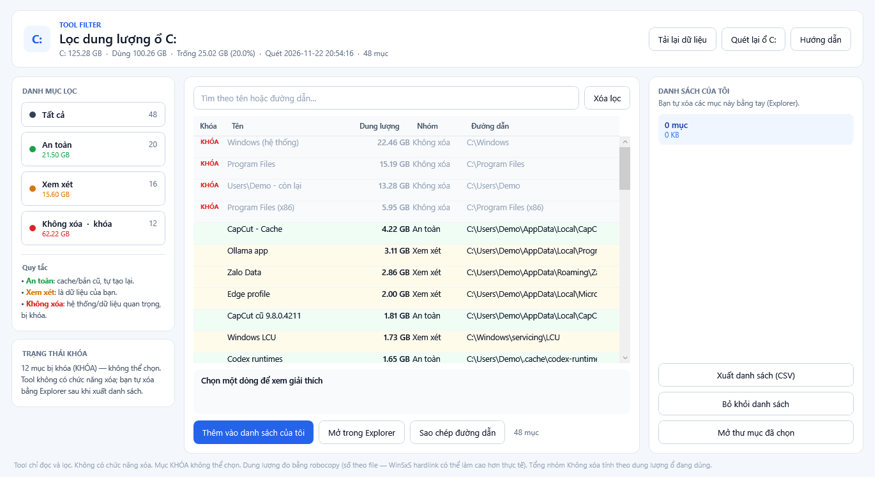

<p align="center">
  
</p>

<h1 align="center">Tool Filter</h1>

<p align="center">
  <b>Lọc dung lượng ổ C: — chỉ đọc, không xóa</b><br>
  Ứng dụng desktop portable cho Windows 10/11 · không cần cài đặt · không cần quyền Administrator
</p>

<p align="center">
  
  
  
  
</p>



---

## Giới thiệu

**Tool Filter** quét toàn bộ ổ **C:** ở chế độ **chỉ đọc**, đo dung lượng từng thư mục và chia thành **3 nhóm** để bạn dễ quyết định nên dọn gì:

| Nhóm | Màu | Ý nghĩa | Chọn được? |
|---|---|---|---|
| **An toàn** | 🟢 xanh | Cache, bản cũ, file tạm — tự tạo lại, không ảnh hưởng dữ liệu | ✅ |
| **Xem xét** | 🟡 vàng | Dữ liệu của bạn hoặc thành phần cần cân nhắc | ✅ |
| **Không xóa** | 🔴 đỏ, cột **KHÓA** | Hệ thống, driver, dữ liệu quan trọng | ❌ bị khóa |

Công cụ **không có bất kỳ chức năng xóa nào**. Bạn xem, lọc, gom các mục cần dọn vào *Danh sách của tôi*, xuất CSV — rồi **tự xóa bằng tay** trong File Explorer.

## Vì sao có công cụ này

Khi ổ C: đầy, các công cụ “dọn dẹp một nút” thường xóa quá tay. Tool Filter làm ngược lại:

- **Chỉ đọc** — không xóa, không sửa, không đổi quyền của bất kỳ file nào.
- **Phân loại rõ ràng** — biết chắc mục nào an toàn, mục nào phải giữ.
- **Bạn quyết định** — không có nút “xóa tất cả”, không tự động dọn.
- **Minh bạch** — mỗi mục có lý do và gợi ý xử lý; số liệu khớp với dung lượng ổ.

## Tính năng

- ⚡ **Quét nhanh ~2 phút** cho ~700.000 file (dùng `robocopy /L`, không copy gì).
- 🗂️ **Ba nhóm rõ ràng** với giải thích cho từng mục.
- 🔎 **Tìm kiếm & lọc** theo tên, đường dẫn, nhóm; sắp xếp theo dung lượng.
- 📋 **Danh sách của tôi** — gom các mục muốn dọn, tính tổng dung lượng.
- 📤 **Xuất CSV** (đường dẫn, dung lượng, nhóm, lý do) để đối chiếu hoặc lưu trữ.
- 🔒 **Mục “Không xóa” bị khóa** — không thể chọn hay đưa vào danh sách.
- 🖱️ **Nhấp đúp** một dòng để mở thư mục trong Explorer.
- 🧳 **Portable** — giải nén và chạy, không registry, không service, không admin.
- 🌐 **Không gửi dữ liệu đi đâu** — không telemetry, không mạng.

## Tải và chạy

### Cách 1 — Bản portable (khuyến nghị)

1. Vào mục **[Releases](../../releases)** và tải `ToolFilter-Portable-v1.0.0.zip`.
2. Giải nén **toàn bộ** thư mục (đừng chỉ lấy file `.exe`).
3. Nhấp đôi **`ToolFilter.exe`**.
4. Lần đầu, bấm **“Quét lại ổ C:”** (khoảng 2–4 phút). Khi cửa sổ quét đóng, bấm **“Tải lại dữ liệu”**.

> **Yêu cầu:** Windows 10/11, PowerShell 5.1 (có sẵn). Không cần cài .NET hay Python.

> **SmartScreen:** file `.exe` chưa ký số nên Windows có thể hiện “Windows protected your PC”. Bấm **More info → Run anyway**. Mã nguồn đầy đủ nằm trong repo để bạn tự kiểm tra và tự build.

### Cách 2 — Từ mã nguồn

```powershell
git clone https://github.com/<your-user>/tool-filter.git
cd tool-filter
powershell -ExecutionPolicy Bypass -File .\build\Build-Portable.ps1
.\app\ToolFilter.exe
```

Hoặc chạy trực tiếp bằng PowerShell:

```powershell
powershell -NoProfile -STA -ExecutionPolicy Bypass -File .\Tool-Filter.ps1
```

## Cách dùng

1. **Chọn nhóm** ở cột trái: Tất cả / An toàn / Xem xét / Không xóa.
2. **Gõ ô tìm kiếm** để lọc theo tên hoặc đường dẫn.
3. **Chọn dòng** (Ctrl / Shift để chọn nhiều) → **“Thêm vào danh sách của tôi”**.
4. **“Xuất danh sách (CSV)”** để lưu kế hoạch dọn dẹp.
5. **Tự xóa bằng tay** trong File Explorer (nên Shift+Delete với nhóm An toàn).
6. Quét lại khi cần: **“Quét lại ổ C:”** → **“Tải lại dữ liệu”**.

> Trước khi xóa: đóng ứng dụng liên quan (CapCut, Zalo, trình duyệt…).

## Phân loại như thế nào

### 🟢 An toàn
Cache và bản cũ có thể tạo lại, không ảnh hưởng dữ liệu:

- Các bản **CapCut cũ** trong `AppData\Local\CapCut\Apps` (giữ bản đang dùng).
- `CapCut\User Data\Cache`, `CapCut\User Data\Download`.
- `AppData\Local\Temp`, `C:\Windows\Temp`.
- `.cache\codex-runtimes`, `AppData\Local\electron`.
- Bộ cài cập nhật đã tải: OpenCode, Antigravity, draw.io, PowerToys, GitHub Desktop, EdgeUpdate.
- `DeliveryOptimization`, `SoftwareDistribution\Download`, `C:\Windows\Logs`.
- `$Recycle.Bin` (Thùng rác).

### 🟡 Xem xét
Dữ liệu của bạn hoặc cần cân nhắc trước khi xóa:

- `CapCut\Videos`, `ZaloData`, `Recordly\recordings`, `Downloads`.
- Profile/cache Edge, Office, CocCoc, Google.
- `.gemini`, `.codex`, dữ liệu OpenCode, Ollama app, WSL Debian.
- `Windows\servicing\LCU`, `MRT.exe`, `C:\Tools`.

### 🔴 Không xóa (khóa)
Hệ thống và dữ liệu quan trọng — tool chặn không cho chọn:

- `C:\Windows` (phần còn lại sau khi trừ mục an toàn/xem xét).
- `C:\Program Files`, `C:\Program Files (x86)`, `C:\ProgramData`.
- `Documents`, `Desktop`, `Pictures`, `Videos`, `Music`, `OneDrive`, `Zomboid`.
- `C:\Recovery`, `System Volume Information`, `pagefile.sys`, `swapfile.sys`.
- Các thư mục gốc còn lại (`AiO-Files`, `MATS`, `evkey`, `Intel`, `Dell`, `inetpub`, `PerfLogs`, `XboxGames`…).
- **Mọi đường dẫn không khớp quy tắc an toàn → mặc định khóa.**

Quy tắc nằm trong [`Scan.ps1`](Scan.ps1); bạn có thể đọc và chỉnh theo nhu cầu.

## Cách hoạt động

- Quét bằng `robocopy /L` (**liệt kê**, không copy) với `/XJ` để bỏ qua junction, nên nhanh và không đếm trùng.
- Không mở, không đọc nội dung, không ghi file trong lúc quét.
- Dung lượng là **tổng kích thước file**. `WinSxS` dùng hardlink nên tổng theo file có thể cao hơn thực tế; vì vậy:
  - Tổng **An toàn** và **Xem xét** = cộng các mục đã đo.
  - Tổng **Không xóa** = *dung lượng ổ đang dùng* − An toàn − Xem xét → luôn khớp với ổ C:.
  - Dòng “Phần hệ thống còn lại của ổ” bù phần chênh lệch (MFT, System Restore, thư mục bị chặn quyền).
- Các mục nhỏ hơn 1 MB được ẩn cho gọn; chúng vẫn nằm trong tổng của ổ.
- Kết quả lưu tại `data\index.json`, nhật ký tại `data\scan.log` (chỉ trên máy bạn).

## Khóa hoạt động thế nào

1. **Không có mã xóa** — tool không chứa `Remove-Item`, `del`, `rd`… nên không thể tự xóa.
2. **Không thể chọn** — mục thuộc nhóm “Không xóa” bị từ chối khi thêm vào danh sách.
3. **Windows chặn sẵn** — các thư mục hệ thống yêu cầu quyền Administrator mới xóa được.

**Giới hạn cần biết:** tool không đặt ACL `Deny Delete` tự động. Windows dùng cùng quyền `DELETE` cho việc xóa và đổi tên/ghi đè; chặn cứng sẽ khiến Word/Excel không lưu được trong thư mục đó. Nếu bạn cần khóa cứng một thư mục lưu trữ cụ thể, hãy mở issue để được hướng dẫn riêng.

## Quyền riêng tư

- Không có kết nối mạng, không telemetry, không upload dữ liệu.
- `data\index.json` chứa **đường dẫn thật trên máy bạn** — đừng commit hoặc chia sẻ file này (đã nằm trong `.gitignore`).
- Tool không yêu cầu quyền Administrator; một số thư mục hệ thống sẽ không đọc được và được ghi chú rõ.

## Cấu trúc repo

```
.
├─ Tool-Filter.ps1          # Giao diện WPF (sáng, tiếng Việt)
├─ Scan.ps1                 # Quét chỉ đọc + phân loại 3 nhóm
├─ Start-Tool.cmd           # Chạy nhanh từ mã nguồn
├─ build/
│  ├─ Build-Portable.ps1    # Đóng gói app\ + dist\*.zip
│  ├─ Launcher.cs           # EXE launcher (không console)
│  ├─ New-Icon.ps1          # Sinh icon/logo
│  ├─ New-Screenshot.ps1    # Sinh ảnh README (dữ liệu mẫu)
│  ├─ PORTABLE-README.md    # README trong bản portable
│  ├─ Troubleshoot.cmd      # Chạy kèm console để xem lỗi
│  └─ app.ico
├─ docs/                    # logo + screenshot
├─ app/                     # (build) bản portable
├─ dist/                    # (build) file ZIP
├─ .github/workflows/       # Tự động build khi tag v*
├─ LICENSE
└─ README.md
```

## Build & phát hành

```powershell
# Tạo app\ và dist\ToolFilter-Portable-v1.0.0.zip
powershell -ExecutionPolicy Bypass -File .\build\Build-Portable.ps1 -Version 1.0.0
```

Phát hành lên GitHub:

```powershell
git tag v1.0.0
git push origin v1.0.0
```

Workflow [`release.yml`](.github/workflows/release.yml) sẽ tự build trên Windows và đính kèm file ZIP vào Release.

## Hạn chế đã biết

- Chỉ hỗ trợ ổ **C:** (đường dẫn phân loại được thiết kế cho ổ hệ thống).
- Một số thư mục (`System Volume Information`, `Recovery`, `WindowsApps`…) bị chặn quyền — không đo được nếu không chạy admin.
- Số liệu theo file có thể cao hơn dung lượng thật do hardlink của `WinSxS`.
- File `.exe` chưa ký số → SmartScreen có thể cảnh báo.
- Chưa có bản dịch tiếng Anh cho giao diện (README có tóm tắt tiếng Anh bên dưới).

## Đóng góp

Mọi góp ý, báo lỗi và pull request đều được hoan nghênh:

1. Mở **Issue** mô tả vấn đề hoặc đề xuất.
2. Fork repo, tạo nhánh (`feature/ten-tinh-nang`).
3. Chạy `build\Build-Portable.ps1` để kiểm tra trước khi gửi PR.

## Giấy phép

Phát hành theo giấy phép **MIT** — xem [LICENSE](LICENSE).

---

## English (short)

**Tool Filter** is a read-only Windows desktop app that scans drive **C:**, measures folder sizes, and classifies them into **Safe / Review / Protected**. It **never deletes anything** — you review the list, export CSV, and delete manually in Explorer. Portable, no install, no admin, no telemetry. Built with PowerShell 5.1 + WPF; sizes are measured with `robocopy /L`.

Download the latest portable ZIP from **Releases**, extract, and run `ToolFilter.exe`.

Licensed under MIT.
